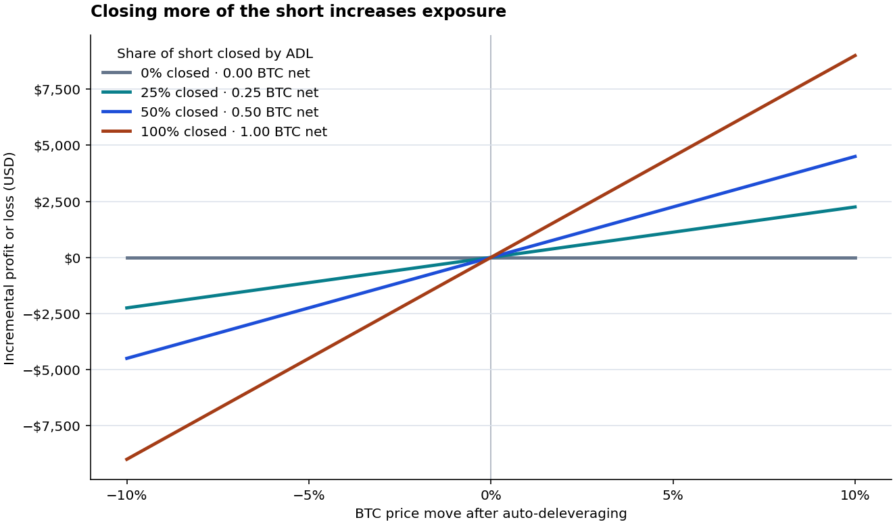

# ADL Hedge Analysis

**How much of a BTC hedge do you need to put back after auto-deleveraging?** The worked example in *The Price of Solvency* compares leaving a disrupted hedge alone with restoring it in full. This notebook looks at what happens in between.

Take a portfolio with 1 BTC of spot and an equal perpetual short. At $90,000, auto-deleveraging (ADL) closes half the short, leaving 0.5 BTC net long. Say you want to keep the loss from a further 5% drop within a $1,000 limit, including the cost of putting the hedge back. At an assumed execution cost of 50 basis points, you’d need to replace about **0.309 BTC** of the short, or **62% of the amount ADL closed**.

| Short put back | Loss from the 5% drop | Execution cost | Combined loss |
| --- | ---: | ---: | ---: |
| 0 BTC | $2,250.00 | $0.00 | $2,250.00 |
| 0.25 BTC | $1,125.00 | $112.50 | $1,237.50 |
| ≈0.309 BTC | $861.11 | $138.89 | $1,000.00 |
| 0.50 BTC | $0.00 | $225.00 | $225.00 |

The table uses the unrounded hedge size. If you budgeted only for the price move, you’d replace about 0.278 BTC and still end up about $125 over the cap. In the notebook, you can change the size of the assumed drop or the cost of trading and see how the answer moves.



## Run the notebook

[Open the notebook](adl_hedge_analysis.ipynb) on GitHub to see the calculations. To change the inputs, open a terminal in the repository folder and run:

```sh
python -m pip install -r requirements.txt
python -m notebook adl_hedge_analysis.ipynb
```

Change the inputs in the first code cell and run all cells.

## Where the numbers come from

The starting position comes from Maxine Koh Xin Yi’s *The Price of Solvency: When the Exchange Survives, but the Hedge Doesn't* (Blockchain @ NTU, October 2026). The $1,000 limit and the price shocks are hypothetical. The model assumes the new short fills immediately at the ADL price, with one execution charge proportional to size. It treats spot and perpetual price moves as equal and leaves out funding, basis, and ADL settlement effects. The calculation starts after ADL and covers the next price move.

## Further reading

The paper explains how a hedge can break. The notebook asks how much of it you need to restore to stay within a given loss limit.

- [The Price of Solvency (PDF)](research/the-price-of-solvency.pdf)
- [Companion reading guide (PDF)](research/adl-reading-guide.pdf)
